<div align="center">
  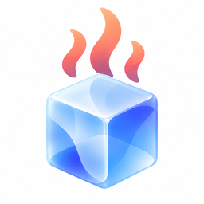

<h1 align="center">Atte</h1>

<p align="center">
  A minimal, lightweight coding agent app for developers tired of complex ADEs.
</p>

<p align="center">
  <a href="#download">Download</a> ·
  <a href="#features">Features</a> ·
  <a href="#development">Development</a>
</p>

</div>

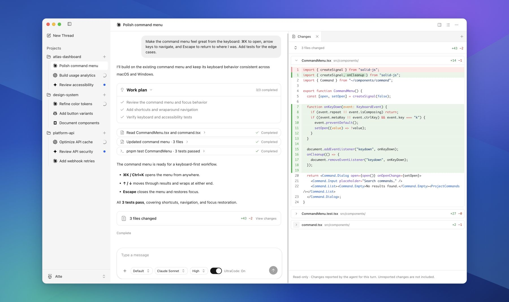

Atte brings your coding agents together in a minimal desktop interface. Choose an agent, open a local folder, and start a thread.

## Download

**[Download the latest release for macOS →](https://github.com/richpin/atte/releases/latest)**

Currently available for **Apple Silicon Macs (ARM64) only**.

1. Download the `.dmg` file from the latest release.
2. Open it and drag Atte to **Applications**.
3. Launch Atte and open **Settings → Agents** to install an agent. Complete sign-in when prompted.
4. Create a thread, choose a working folder and an agent, and start working.

Check for updates in **Settings → General**.

## Features

- Work across projects with multiple agents and parallel threads.
- Keep tasks separate with Git worktrees.
- Review Git changes and create commits in the side panel.
- Browse files, edit code, and open web pages beside your conversation.
- Queue follow-ups and add context with file mentions and attachments.
- Light, dark, and system themes, with English and Korean interfaces.

## Supported agents

Atte connects to agents through the **Agent Client Protocol (ACP)**. Available agents include:

<p align="center">
  <kbd>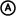 Agoragentic</kbd> &nbsp;
  <kbd>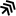 Amp</kbd> &nbsp;
  <kbd>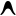 Google&nbsp;Antigravity</kbd> &nbsp;
  <kbd>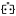 Auggie&nbsp;CLI</kbd> &nbsp;
  <kbd>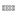 Autohand&nbsp;Code</kbd> &nbsp;
  <kbd>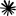 Claude&nbsp;Agent</kbd> &nbsp;
  <kbd>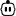 Cline</kbd> &nbsp;
  <kbd>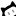 Codebuddy&nbsp;Code</kbd> &nbsp;
  <kbd>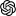 Codex</kbd> &nbsp;
  <kbd>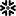 Cortex&nbsp;Code</kbd> &nbsp;
  <kbd>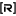 Corust&nbsp;Agent</kbd> &nbsp;
  <kbd>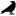 crow-cli</kbd> &nbsp;
  <kbd>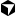 Cursor</kbd> &nbsp;
  <kbd>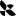 DeepAgents</kbd> &nbsp;
  <kbd>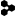 Devin</kbd> &nbsp;
  <kbd>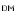 DimCode</kbd> &nbsp;
  <kbd>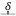 Dirac</kbd> &nbsp;
  <kbd>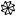 Factory&nbsp;Droid</kbd> &nbsp;
  <kbd>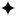 Gemini&nbsp;CLI</kbd> &nbsp;
  <kbd>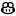 Copilot</kbd> &nbsp;
  <kbd>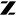 GLM&nbsp;Agent</kbd> &nbsp;
  <kbd>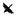 goose</kbd> &nbsp;
  <kbd>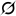 Grok&nbsp;Build</kbd> &nbsp;
  <kbd>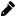 Harn</kbd> &nbsp;
  <kbd>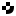 Junie</kbd> &nbsp;
  <kbd>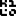 Kilo</kbd> &nbsp;
  <kbd>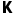 Kimchi</kbd> &nbsp;
  <kbd>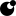 Kimi&nbsp;CLI</kbd> &nbsp;
  <kbd>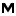 MiniMax&nbsp;Code</kbd> &nbsp;
  <kbd>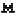 Mistral&nbsp;Vibe</kbd> &nbsp;
  <kbd>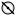 Nova</kbd> &nbsp;
  <kbd>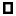 OpenCode</kbd> &nbsp;
  <kbd>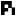 pi&nbsp;ACP</kbd> &nbsp;
  <kbd>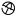 Poolside</kbd> &nbsp;
  <kbd>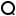 Qoder&nbsp;CLI</kbd> &nbsp;
  <kbd>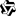 Qwen&nbsp;Code</kbd> &nbsp;
  <kbd>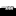 siGit&nbsp;Code</kbd> &nbsp;
  <kbd>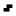 Stakpak</kbd> &nbsp;
  <kbd>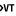 VT&nbsp;Code</kbd>
</p>

Install agents in **Settings → Agents**, powered by the [ACP registry](https://github.com/agentclientprotocol/registry). Availability depends on your platform and the agent's distribution; features and sign-in requirements vary by agent.

## Development

Built with **Tauri 2**, **SolidJS**, and **Rust**. Active development happens on `develop`; `main` tracks releases.

To run from source, install Node.js (22.12+), pnpm, Rust, and the [Tauri prerequisites for macOS](https://v2.tauri.app/start/prerequisites/#macos).

```sh
git clone https://github.com/richpin/atte.git
cd atte
git switch develop
pnpm install
pnpm tauri dev
```

Run the checks:

```sh
pnpm validate
cargo test --manifest-path src-tauri/Cargo.toml --all-features --locked
```

Build locally with `pnpm tauri build`. For signed and notarized distribution builds, see the [macOS release guide](docs/release-macos.md).

## License

Atte is licensed under the [MIT License](https://opensource.org/license/mit). Third-party agents retain their own licenses and terms.
