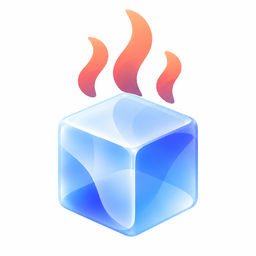

<div align="center">
  

<h1 align="center">Atte</h1>

<p align="center">
  Your coding agents, one consistent interface.
</p>

<p align="center">
  <a href="#features">Features</a> ·
  <a href="#getting-started">Getting started</a> ·
  <a href="#development">Development</a>
</p>

</div>

---

Atte is a desktop app that brings coding agents into a consistent interface. Choose an agent, open a local folder, and start a thread—all in one place.

Currently in development, with macOS as the first target.

## Supported agents

Atte connects to agents through the **Agent Client Protocol (ACP)**. Available agents include:

<p align="center">
  <kbd> Agoragentic</kbd> &nbsp;
  <kbd> Amp</kbd> &nbsp;
  <kbd> Google&nbsp;Antigravity</kbd> &nbsp;
  <kbd> Auggie&nbsp;CLI</kbd> &nbsp;
  <kbd> Autohand&nbsp;Code</kbd> &nbsp;
  <kbd> Claude&nbsp;Agent</kbd> &nbsp;
  <kbd> Cline</kbd> &nbsp;
  <kbd> Codebuddy&nbsp;Code</kbd> &nbsp;
  <kbd> Codex</kbd> &nbsp;
  <kbd> Cortex&nbsp;Code</kbd> &nbsp;
  <kbd> Corust&nbsp;Agent</kbd> &nbsp;
  <kbd> crow-cli</kbd> &nbsp;
  <kbd> Cursor</kbd> &nbsp;
  <kbd> DeepAgents</kbd> &nbsp;
  <kbd> Devin</kbd> &nbsp;
  <kbd> DimCode</kbd> &nbsp;
  <kbd> Dirac</kbd> &nbsp;
  <kbd> Factory&nbsp;Droid</kbd> &nbsp;
  <kbd> Gemini&nbsp;CLI</kbd> &nbsp;
  <kbd> Copilot</kbd> &nbsp;
  <kbd> GLM&nbsp;Agent</kbd> &nbsp;
  <kbd> goose</kbd> &nbsp;
  <kbd> Grok&nbsp;Build</kbd> &nbsp;
  <kbd> Harn</kbd> &nbsp;
  <kbd> Junie</kbd> &nbsp;
  <kbd> Kilo</kbd> &nbsp;
  <kbd> Kimchi</kbd> &nbsp;
  <kbd> Kimi&nbsp;CLI</kbd> &nbsp;
  <kbd> MiniMax&nbsp;Code</kbd> &nbsp;
  <kbd> Mistral&nbsp;Vibe</kbd> &nbsp;
  <kbd> Nova</kbd> &nbsp;
  <kbd> OpenCode</kbd> &nbsp;
  <kbd> pi&nbsp;ACP</kbd> &nbsp;
  <kbd> Poolside</kbd> &nbsp;
  <kbd> Qoder&nbsp;CLI</kbd> &nbsp;
  <kbd> Qwen&nbsp;Code</kbd> &nbsp;
  <kbd> siGit&nbsp;Code</kbd> &nbsp;
  <kbd> Stakpak</kbd> &nbsp;
  <kbd> VT&nbsp;Code</kbd>
</p>

Install agents in **Settings → Agents**, powered by the [ACP registry](https://github.com/agentclientprotocol/registry). Availability depends on your platform and the agent's distribution; features and sign-in requirements vary by agent.

## Features

- **Your choice of agent.** Browse and install agents from the Agent Client Protocol (ACP) registry.
- **Work across projects.** Keep threads organized by working folder and run multiple threads at once.
- **Follow the work.** Read streaming responses, inspect tool calls and file changes, and respond to permission requests.
- **Keep the conversation going.** Queue follow-up messages and resume threads with agents that support it.
- **Make it yours.** Light, dark, and system themes, with English and Korean interfaces.

## Getting started

To run from source, install Node.js (22.12+), pnpm, Rust, and the [Tauri prerequisites for macOS](https://v2.tauri.app/start/prerequisites/#macos).

```sh
git clone https://github.com/richpin/atte.git
cd atte
pnpm install
pnpm tauri dev
```

In the app, open **Settings → Agents** to install an agent. Create a new thread, choose a working folder and an agent, and complete sign-in when prompted.

## Development

Built with **Tauri 2**, **SolidJS**, and **Rust**.

```sh
pnpm validate
cargo test --manifest-path src-tauri/Cargo.toml --all-features --locked
```

Build the macOS app with `pnpm tauri build`.

## License

Atte is licensed under the [MIT License](https://opensource.org/license/mit). Third-party agents retain their own licenses and terms.
