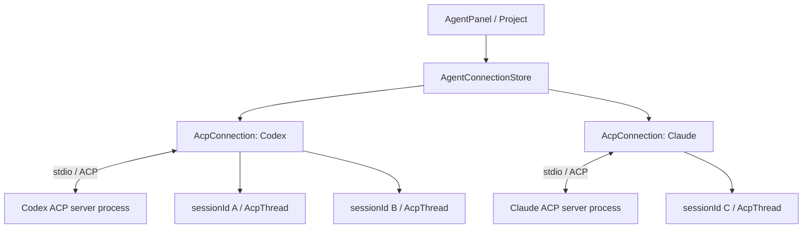

# Zed의 ACP 연결과 세션 관리

조사일: 2026-09-16 (Asia/Seoul).
대상: zed-industries/zed의 main 스냅샷 `739fdbef762f7e514d62e1fa650c1b7cac5bbff4` (2026-09-15 23:25:47 UTC).
방법: 공개 저장소의 관련 Rust 소스를 부분 복제해 호출 경로와 기존 테스트를 정적으로 확인했다. Zed를 빌드하거나 실제 에이전트와 연결해 실행 검증하지는 않았다. 따라서 아래 설명은 이 커밋의 구현이며, 설치된 stable 버전의 동작과는 다를 수 있다.

## 핵심 결론

Zed는 공통 ACP 구현을 사용하면서, **같은 프로젝트의 AgentPanel 안에서 같은 에이전트의 여러 세션이 하나의 연결과 서버 프로세스를 재사용**한다. 연결을 스레드마다 새로 만드는 구조가 아니다.

`AgentPanel`이 자신의 `Project`를 전달해 `AgentConnectionStore`를 만들고, store는 `Agent`를 키로 연결을 캐시한다. 외부 에이전트의 키는 `Agent::Custom { id: AgentId }`다. 이는 앱 전체에 하나인 전역 연결과도 다르다.
근거: [패널의 store 생성](https://github.com/zed-industries/zed/blob/739fdbef762f7e514d62e1fa650c1b7cac5bbff4/crates/agent_ui/src/agent_panel.rs#L1538), [연결 캐시](https://github.com/zed-industries/zed/blob/739fdbef762f7e514d62e1fa650c1b7cac5bbff4/crates/agent_ui/src/agent_connection_store.rs#L69-L82), [Agent 키](https://github.com/zed-industries/zed/blob/739fdbef762f7e514d62e1fa650c1b7cac5bbff4/crates/agent_ui/src/agent_ui.rs#L425-L448).

이 구조는 앞서 논의한 “shared client”를 더 정확히 정의한다. 공유하는 것은 구현 코드뿐 아니라 같은 실행 환경의 같은 서버에 대한 live connection일 수도 있다. 다만 다른 에이전트 서버를 하나의 stdio 스트림으로 합치는 것은 아니다. 아래 그림의 세션 수는 예시다.

## 코드의 책임 분리

| 코드 | 책임 |
| --- | --- |
| `project/src/agent_server_store.rs` | Custom/Registry 설정을 실행 명령·인자·환경변수로 변환하고 필요한 배포물을 준비 |
| `agent_servers/src/custom.rs` | 공통 외부 AgentServer 구현. 실행 설정과 일부 에이전트별 보정을 거쳐 연결 |
| `agent_ui/src/agent_connection_store.rs` | 패널/프로젝트 범위의 연결 캐시, 동시 연결 요청 병합, 명시적 재연결 |
| `agent_servers/src/acp.rs` | 프로세스·stdio·초기화, SDK 요청 처리, 세션 라우팅 |
| `acp_thread/src/connection.rs` | UI와 스레드 모델이 사용하는 `AgentConnection` 추상화 |
| `acp_thread/src/acp_thread.rs` | 세션별 메시지·도구 호출·권한·turn·터미널·표시 상태 |
| `agent_ui/src/thread_metadata_store.rs` | 사이드바에 표시할 영속 thread 식별자와 메타데이터 |
| `agent_ui/src/conversation_view.rs` | 연결/인증/스레드 복원 상태와 화면 구성 |

이들은 모두 위 커밋의 `crates/` 아래 경로다. 외부 에이전트는 `CustomAgentServer`로 들어가고, Zed 내장 에이전트는 별도 `NativeAgentServer`를 사용한다. 공통 UI 인터페이스를 사용한다고 해서 내장 에이전트까지 외부 stdio 프로세스로 실행하는 것은 아니다.
근거: [Agent::server](https://github.com/zed-industries/zed/blob/739fdbef762f7e514d62e1fa650c1b7cac5bbff4/crates/agent_ui/src/agent_ui.rs#L483-L495), [AgentConnection trait](https://github.com/zed-industries/zed/blob/739fdbef762f7e514d62e1fa650c1b7cac5bbff4/crates/acp_thread/src/connection.rs#L91-L259).

## 1. 연결을 만들고 재사용하는 과정

1. 스레드 화면이 `AgentConnectionStore::request_connection`을 호출한다.
2. 같은 키가 있으면 기존 entry를 반환한다. 아직 연결 중이면 `Shared<Task<…>>`를 기다리므로 동시에 스레드를 열어도 연결 작업을 중복 시작하지 않는다.
3. 새 연결이면 `CustomAgentServer::connect`가 실행할 명령을 가져와 `acp::connect → AcpConnection::stdio`로 전달한다.
4. 초기 연결 성공 시 entry가 `Connected`로 바뀐다. 초기 연결 실패 시 오류를 전달하고 캐시에서 제거한다.

근거: [request_connection과 shared task](https://github.com/zed-industries/zed/blob/739fdbef762f7e514d62e1fa650c1b7cac5bbff4/crates/agent_ui/src/agent_connection_store.rs#L143-L207), [실행 명령과 connect](https://github.com/zed-industries/zed/blob/739fdbef762f7e514d62e1fa650c1b7cac5bbff4/crates/agent_servers/src/custom.rs#L248-L279).

Custom 설정은 사용자가 지정한 명령을 이용한다. Registry 설정은 binary archive와 npm 배포를 구분하지만, 둘 다 최종적으로 `AgentServerCommand { path, args, env }`로 수렴한다.
근거: [AgentServerCommand](https://github.com/zed-industries/zed/blob/739fdbef762f7e514d62e1fa650c1b7cac5bbff4/crates/project/src/agent_server_store.rs#L34-L41), [Custom/Registry 분기](https://github.com/zed-industries/zed/blob/739fdbef762f7e514d62e1fa650c1b7cac5bbff4/crates/project/src/agent_server_store.rs#L359-L443).

## 2. 프로세스와 ACP transport

`AcpConnection::stdio`는 로컬 프로젝트의 작업 경로와 환경변수를 설정하고 stdin/stdout/stderr를 pipe로 연결해 자식 프로세스를 시작한다. 원격 프로젝트는 remote client가 실행 명령을 구성하는 별도 분기가 있다.

stdout을 줄 단위로 읽고 stdin에 줄바꿈을 붙여 쓰는 `Lines` transport를 사용한다. stderr는 별도 작업에서 진단 로그로 처리한다. SDK `Client.builder()`에 agent→client 요청/알림 handler를 등록하고, `ConnectionTo<Agent>`를 얻는다.

이 커밋은 SDK 패키지 `agent-client-protocol = 2.1.0`을 사용하지만, wire 초기화는 `ProtocolVersion::V1`이다. SDK 패키지 버전과 ACP 프로토콜 버전은 구분해야 한다.

근거: [stdio와 background I/O](https://github.com/zed-industries/zed/blob/739fdbef762f7e514d62e1fa650c1b7cac5bbff4/crates/agent_servers/src/acp.rs#L799-L929), [SDK client builder](https://github.com/zed-industries/zed/blob/739fdbef762f7e514d62e1fa650c1b7cac5bbff4/crates/agent_servers/src/acp.rs#L664-L751), [SDK 의존성](https://github.com/zed-industries/zed/blob/739fdbef762f7e514d62e1fa650c1b7cac5bbff4/Cargo.toml#L521), [initialize](https://github.com/zed-industries/zed/blob/739fdbef762f7e514d62e1fa650c1b7cac5bbff4/crates/agent_servers/src/acp.rs#L971-L1009).

초기화 응답의 agent capabilities, 인증 방법, 에이전트 버전은 연결에 보관한다. 세션별 mode/config는 별도로 관리한다. 파일·터미널·질문 UI 등은 Zed가 지원한다고 광고하는 client capability이며, 서버가 제공하는 capability와 방향이 다르다.
근거: [client capabilities](https://github.com/zed-industries/zed/blob/739fdbef762f7e514d62e1fa650c1b7cac5bbff4/crates/agent_servers/src/acp.rs#L753-L786), [연결 상태 필드](https://github.com/zed-industries/zed/blob/739fdbef762f7e514d62e1fa650c1b7cac5bbff4/crates/agent_servers/src/acp.rs#L396-L415), [초기화 결과 보관](https://github.com/zed-industries/zed/blob/739fdbef762f7e514d62e1fa650c1b7cac5bbff4/crates/agent_servers/src/acp.rs#L1077-L1097).

세션 생성/복원 중 `AuthRequired`가 반환되면 인증 화면으로 전환한다. 인증 방식에 따라 ACP `authenticate`를 보내거나 별도 로그인 터미널을 실행하고, 성공 후 세션 생성/복원을 다시 시도한다. 프로토콜 연결 성립과 계정 인증 완료를 별개의 상태로 다룬다.
근거: [AuthRequired 처리](https://github.com/zed-industries/zed/blob/739fdbef762f7e514d62e1fa650c1b7cac5bbff4/crates/agent_ui/src/conversation_view.rs#L1178-L1188), [인증 실행과 재시도](https://github.com/zed-industries/zed/blob/739fdbef762f7e514d62e1fa650c1b7cac5bbff4/crates/agent_ui/src/conversation_view.rs#L1924-L2055).

## 3. 연결 하나에서 여러 세션을 관리하는 과정

연결은 `sessions: HashMap<SessionId, AcpSession>`를 가진다. 각 `AcpSession`은 스레드 모델 `AcpThread`의 약한 참조와 해당 세션의 mode/config를 보관한다. 스레드 모델은 공유 연결의 강한 참조를 가진다.

새 세션은 작업 디렉터리와 프로젝트의 MCP 설정을 포함한 `session/new` 요청으로 만든다. 서버가 반환한 `sessionId`로 스레드 모델을 생성하고 map에 등록한다. 추가 디렉터리는 서버 지원 여부에 따라 처리한다.
근거: [연결과 세션 구조](https://github.com/zed-industries/zed/blob/739fdbef762f7e514d62e1fa650c1b7cac5bbff4/crates/agent_servers/src/acp.rs#L396-L525), [new_session](https://github.com/zed-industries/zed/blob/739fdbef762f7e514d62e1fa650c1b7cac5bbff4/crates/agent_servers/src/acp.rs#L1617-L1723).

사용자가 전송하면 `AcpThread`가 자신의 `sessionId`를 담아 prompt를 호출한다. 수신한 `session/update`는 ID로 스레드를 찾아 메시지/도구/계획/설정 상태에 반영된다. 등록되지 않은 세션의 알림은 현재 구현에서 경고 후 버린다.
근거: [전송](https://github.com/zed-industries/zed/blob/739fdbef762f7e514d62e1fa650c1b7cac5bbff4/crates/acp_thread/src/acp_thread.rs#L3964-L4025), [알림 라우팅](https://github.com/zed-industries/zed/blob/739fdbef762f7e514d62e1fa650c1b7cac5bbff4/crates/agent_servers/src/acp.rs#L4797-L4847).

세션마다 `running_turn`, entries, plan, terminals가 존재하므로 스레드 상태는 분리된다. 하지만 이것이 서버 내부의 병렬 추론 처리나 파일 시스템 격리까지 보장하지는 않는다. 같은 연결의 모든 세션은 서버 프로세스 장애의 영향을 함께 받을 수 있다.
근거: [AcpThread 상태](https://github.com/zed-industries/zed/blob/739fdbef762f7e514d62e1fa650c1b7cac5bbff4/crates/acp_thread/src/acp_thread.rs#L2292-L2328), [프로세스 종료 알림](https://github.com/zed-industries/zed/blob/739fdbef762f7e514d62e1fa650c1b7cac5bbff4/crates/agent_servers/src/acp.rs#L1011-L1017). 마지막 두 문장은 해당 소유 구조에서 도출한 설계상 해석이다.

같은 세션의 turn 처리는 기존 turn 취소 완료를 기다린 뒤 다음 실행을 시작한다. 증가하는 `turn_id`를 비교해 이전 요청의 늦은 완료가 새로운 실행 상태를 지우지 않도록 한다.
근거: [run_turn의 세대 검사](https://github.com/zed-industries/zed/blob/739fdbef762f7e514d62e1fa650c1b7cac5bbff4/crates/acp_thread/src/acp_thread.rs#L4048-L4113).

## 4. 기존 세션 복원과 수명주기

`ConversationView`는 기존 session ID가 있으면 `load_session`을 우선 사용한다. 그것이 없고 `resume_session`을 지원하면 기록 재생 없이 이어가는 경로를 사용하며, 둘 다 없으면 복원 불가 오류를 표시한다.
근거: [복원 분기](https://github.com/zed-industries/zed/blob/739fdbef762f7e514d62e1fa650c1b7cac5bbff4/crates/agent_ui/src/conversation_view.rs#L1138-L1172), [load/resume 의미](https://github.com/zed-industries/zed/blob/739fdbef762f7e514d62e1fa650c1b7cac5bbff4/crates/acp_thread/src/connection.rs#L107-L160).

복원 과정에서 중요한 순서가 있다. `open_or_create_session`은 **load RPC를 기다리기 전에** 스레드 모델을 map에 등록한다. 서버가 load 응답보다 먼저 보내는 과거 `session/update`를 즉시 받을 수 있게 하기 위해서다. 같은 세션의 동시 복원 요청은 `pending_sessions`의 shared task로 병합한다. 이미 메모리에 살아 있는 스레드면 그 모델을 반환한다.
근거: [중복 복원 방지와 선등록](https://github.com/zed-industries/zed/blob/739fdbef762f7e514d62e1fa650c1b7cac5bbff4/crates/agent_servers/src/acp.rs#L1204-L1322).

스레드 모델이 최종 해제되면 해당 map entry를 제거하고 서버가 지원할 때 `session/close`를 보낸다. 서버 프로세스는 연결 객체가 최종 drop될 때 종료한다. 따라서 세션 하나를 닫는 것과 연결 전체를 종료하는 것은 별개다.
근거: [세션 해제 hook](https://github.com/zed-industries/zed/blob/739fdbef762f7e514d62e1fa650c1b7cac5bbff4/crates/agent_servers/src/acp.rs#L1150-L1202), [연결 Drop](https://github.com/zed-industries/zed/blob/739fdbef762f7e514d62e1fa650c1b7cac5bbff4/crates/agent_servers/src/acp.rs#L1549-L1554).

`session/cancel`은 특정 세션의 실행 중 turn을 중단하는 알림이며 연결 프로세스를 죽이지 않는다. `session/delete`는 기록 삭제를 요청하는 별도 기능이며 서버 지원 여부를 검사한다. 즉 cancel, close, delete, process termination을 각각 구분한다.
근거: [취소](https://github.com/zed-industries/zed/blob/739fdbef762f7e514d62e1fa650c1b7cac5bbff4/crates/agent_servers/src/acp.rs#L1957-L1963), [삭제](https://github.com/zed-industries/zed/blob/739fdbef762f7e514d62e1fa650c1b7cac5bbff4/crates/agent_servers/src/acp.rs#L600-L621).

스레드 화면을 바꿔도 `AgentPanel.retained_threads`가 스레드 view를 보유한다. 실제 thread가 있는 항목의 정리 조건은 Idle이고 다시 load할 수 있는 것이며, 오래된 것부터 상한에 맞춰 제거한다. 화면 전환과 작업 중단을 분리한 설계다.
근거: [스레드 보존과 정리](https://github.com/zed-industries/zed/blob/739fdbef762f7e514d62e1fa650c1b7cac5bbff4/crates/agent_ui/src/agent_panel.rs#L4202-L4257).

## 5. 기록 저장과 UI 식별자

사이드바 기록에는 자체 UUID인 `ThreadId`가 있고, 외부 `session_id`는 별도의 optional 필드다. 에이전트 ID, 제목 및 사용자 지정 제목, 작업 폴더/worktree, 시간, 원격 연결, archive 상태 등을 SQLite에 저장한다. 메타데이터상 첫 전송 전 초안은 `session_id: None`으로 표현된다.

외부 세션을 다시 여는 경로에서는 메시지 기록을 서버의 load로 복원한다. 확인한 메타데이터 DB가 외부 에이전트의 전체 transcript를 보관하고 재생하는 구조는 아니다. Zed 내장 에이전트의 자체 기록 저장과도 구분해야 한다.
근거: [ThreadMetadata](https://github.com/zed-industries/zed/blob/739fdbef762f7e514d62e1fa650c1b7cac5bbff4/crates/agent_ui/src/thread_metadata_store.rs#L309-L333), [메타데이터 DB 스키마](https://github.com/zed-industries/zed/blob/739fdbef762f7e514d62e1fa650c1b7cac5bbff4/crates/agent_ui/src/thread_metadata_store.rs#L1424-L1464), [화면의 load/resume 분기](https://github.com/zed-industries/zed/blob/739fdbef762f7e514d62e1fa650c1b7cac5bbff4/crates/agent_ui/src/conversation_view.rs#L1138-L1172).

초안 메타데이터의 `session_id: None`은 아직 `session/new`를 호출하지 않았다는 뜻은 아니다. 런타임에서는 이미 서버 session ID가 있어도 첫 메시지 전에는 그것을 디스크에 저장하지 않는다. 초안이 실제 스레드로 전환될 때 metadata에 session ID를 기록하고 초기 초안 K/V를 삭제한다.
근거: [초안 ID와 저장 전환](https://github.com/zed-industries/zed/blob/739fdbef762f7e514d62e1fa650c1b7cac5bbff4/crates/agent_ui/src/thread_metadata_store.rs#L1282-L1355).

초기 초안의 입력 내용은 `ThreadId`를 키로 별도의 `agent_draft_prompts` K/V namespace에 저장한다. 현재 debounce 저장 경로는 `is_draft_thread()` 조건이 있으므로, 모든 외부 세션의 전송 후 미전송 입력까지 동일하게 영속화한다고 단정하면 안 된다.
근거: [초안 저장소](https://github.com/zed-industries/zed/blob/739fdbef762f7e514d62e1fa650c1b7cac5bbff4/crates/agent_ui/src/draft_prompt_store.rs#L25-L57), [초안 저장 조건](https://github.com/zed-industries/zed/blob/739fdbef762f7e514d62e1fa650c1b7cac5bbff4/crates/agent_ui/src/conversation_view.rs#L1886-L1921).

외부 과거 세션 가져오기는 `session/list`의 pagination을 순회한 뒤 로컬 metadata로 등록하는 별도 흐름이다. 이미 존재하는 항목과 작업 디렉터리가 없는 항목은 건너뛰고, 가져온 항목은 archived 상태로 시작한다.
근거: [세션 목록 순회](https://github.com/zed-industries/zed/blob/739fdbef762f7e514d62e1fa650c1b7cac5bbff4/crates/agent_ui/src/thread_import.rs#L794-L819), [import 항목 구성](https://github.com/zed-industries/zed/blob/739fdbef762f7e514d62e1fa650c1b7cac5bbff4/crates/agent_ui/src/thread_import.rs#L855-L888).

## 6. 파일, 터미널, 권한 UI와의 연결

ACP는 단방향 채팅 출력만 전달하지 않는다. Zed는 파일 읽기/쓰기, 터미널 생성·출력·종료, permission, elicitation 요청을 SDK handler에 등록한다. handler는 background I/O에서 foreground dispatch queue를 통해 GPUI 상태를 갱신한다.
근거: [callback 등록](https://github.com/zed-industries/zed/blob/739fdbef762f7e514d62e1fa650c1b7cac5bbff4/crates/agent_servers/src/acp.rs#L664-L749), [foreground dispatch](https://github.com/zed-industries/zed/blob/739fdbef762f7e514d62e1fa650c1b7cac5bbff4/crates/agent_servers/src/acp.rs#L956-L969).

파일 작업은 해당 세션의 `Project` 및 editor buffer에 연결된다. 쓰기는 기존 buffer snapshot과의 차이를 계산하고 agent 변경 transaction 및 action log를 기록한다. permission은 해당 세션의 승인 UI 결과를 기다려 응답한다.
근거: [buffer 읽기/쓰기](https://github.com/zed-industries/zed/blob/739fdbef762f7e514d62e1fa650c1b7cac5bbff4/crates/acp_thread/src/acp_thread.rs#L4574-L4745), [permission handler](https://github.com/zed-industries/zed/blob/739fdbef762f7e514d62e1fa650c1b7cac5bbff4/crates/agent_servers/src/acp.rs#L4563-L4612).

이 callback 경로는 편집기 기능과의 통합 지점이다. 외부 프로세스가 수행하는 모든 파일·셸 접근을 이 경로만으로 강제 통제한다고 해석해서는 안 된다.

표시 측면에서는 `AcpThread`가 별도의 텍스트 버퍼를 두고 16ms 주기로 받은 텍스트를 조금씩 노출한다. 이는 ACP transport의 기능이 아니라 Zed의 화면 표현 선택이다.
근거: [StreamingTextBuffer](https://github.com/zed-industries/zed/blob/739fdbef762f7e514d62e1fa650c1b7cac5bbff4/crates/acp_thread/src/acp_thread.rs#L2323-L2354).

## 7. 오류 복구와 에이전트별 예외

프로세스가 종료되면 연결의 상태 감시 작업이 관련 세션에 `LoadError`를 전달한다. 이 커밋의 오류 UI에는 Retry 버튼이 있고, 캐시의 연결을 교체한 뒤 기존 session ID와 작업 경로로 화면 상태를 다시 구성한다. 확인한 경로는 사용자 재시도이며, 일반적인 자동 재연결/backoff supervisor로 설명할 근거는 없다.
근거: [종료 감시](https://github.com/zed-industries/zed/blob/739fdbef762f7e514d62e1fa650c1b7cac5bbff4/crates/agent_servers/src/acp.rs#L1011-L1017), [Retry UI](https://github.com/zed-industries/zed/blob/739fdbef762f7e514d62e1fa650c1b7cac5bbff4/crates/agent_ui/src/conversation_view.rs#L2755-L2762), [retry/reset](https://github.com/zed-industries/zed/blob/739fdbef762f7e514d62e1fa650c1b7cac5bbff4/crates/agent_ui/src/conversation_view.rs#L990-L1040), [store restart](https://github.com/zed-industries/zed/blob/739fdbef762f7e514d62e1fa650c1b7cac5bbff4/crates/agent_ui/src/agent_connection_store.rs#L127-L140).

새 어댑터 버전 통지는 캐시를 제거하고 UI에 새 버전을 알린다. 기존 세션이 이전 연결의 참조를 보유할 수 있으므로 캐시 제거가 모든 기존 세션의 즉각적 종료를 의미하지는 않는다.
근거: [새 버전 캐시 처리](https://github.com/zed-industries/zed/blob/739fdbef762f7e514d62e1fa650c1b7cac5bbff4/crates/agent_ui/src/agent_connection_store.rs#L209-L234), [업데이트 알림 표시](https://github.com/zed-industries/zed/blob/739fdbef762f7e514d62e1fa650c1b7cac5bbff4/crates/agent_ui/src/conversation_view.rs#L1080-L1088).

공통 구현 안에도 에이전트별 작은 예외는 남아 있다. Registry 에이전트별 환경변수 보정, Gemini의 terminal 인증 override, Cursor의 metadata capability 등이 확인된다. 따라서 “capability negotiation만으로 모든 차이가 사라진다”는 설명은 실제 Zed와도 맞지 않는다.
근거: [에이전트별 실행 환경](https://github.com/zed-industries/zed/blob/739fdbef762f7e514d62e1fa650c1b7cac5bbff4/crates/agent_servers/src/custom.rs#L225-L253), [Gemini 인증 호환 처리](https://github.com/zed-industries/zed/blob/739fdbef762f7e514d62e1fa650c1b7cac5bbff4/crates/agent_servers/src/acp.rs#L1051-L1069), [Cursor capability metadata](https://github.com/zed-industries/zed/blob/739fdbef762f7e514d62e1fa650c1b7cac5bbff4/crates/agent_servers/src/acp.rs#L753-L764).

배포 버전도 구분이 필요하다. SDK는 정확한 버전을 지정하지만, npm Registry 배포는 min-release-age 설정을 존중하기 위해 Registry 버전을 상한으로 한 범위를 resolve한다. 실제 설치에는 `--save-exact`를 사용한다. Zed가 모든 Registry 어댑터를 항상 Registry의 정확한 버전으로 실행한다고 설명하면 틀린다.
근거: [npm 설치](https://github.com/zed-industries/zed/blob/739fdbef762f7e514d62e1fa650c1b7cac5bbff4/crates/project/src/agent_server_store.rs#L1387-L1423), [상한 범위의 이유](https://github.com/zed-industries/zed/blob/739fdbef762f7e514d62e1fa650c1b7cac5bbff4/crates/project/src/agent_server_store.rs#L1436-L1467).

## 확인한 회귀 테스트

해당 커밋에는 [마지막 스레드 참조 해제](https://github.com/zed-industries/zed/blob/739fdbef762f7e514d62e1fa650c1b7cac5bbff4/crates/agent_servers/src/acp.rs#L4041), [load 응답 전 기록 재생](https://github.com/zed-industries/zed/blob/739fdbef762f7e514d62e1fa650c1b7cac5bbff4/crates/agent_servers/src/acp.rs#L4126), [진행 중 로더 해제](https://github.com/zed-industries/zed/blob/739fdbef762f7e514d62e1fa650c1b7cac5bbff4/crates/agent_servers/src/acp.rs#L4192), [동시 로더 하나 해제](https://github.com/zed-industries/zed/blob/739fdbef762f7e514d62e1fa650c1b7cac5bbff4/crates/agent_servers/src/acp.rs#L4278)를 다루는 테스트가 있다. 테스트의 존재와 내용을 확인했으며 실행 결과를 검증한 것은 아니다.

## Atte에 적용할 때의 제안

아래는 Zed의 사실 설명과 구분되는 설계 제안이며, 확정된 아키텍처 결정은 아니다.

- **공통 ACP 구현과 실행 인스턴스를 분리한다.** SDK 기반 공통 코어를 두고 실행 환경별 connection manager가 연결을 소유하도록 한다.
- **연결 공유 범위를 명시한다.** 같은 에이전트·실행 환경·인증/설정 범위에서는 여러 세션의 재사용을 검토한다. worktree 경로뿐 아니라 프로세스 전역 설정이나 충돌 영향 범위를 이유로 별도 프로세스가 필요한 경우도 허용한다.
- **앱 ThreadId와 원격 session ID를 분리한다.** 초기 초안과 에이전트가 발급한 ID를 안정적으로 연결하고, 내부 식별에는 agent/environment까지 포함해 충돌을 피한다.
- **기록 열람과 에이전트 재개를 별도 기능으로 본다.** Zed 방식처럼 서버 load에 의존할지, Atte가 표시용 기록을 저장해 오프라인에서도 읽게 할지는 명시적으로 결정한다. 표시용 기록이 있어도 원래 에이전트의 내부 상태를 재구성할 수 있다는 뜻은 아니다.
- **복원 중 이벤트와 중복 요청을 설계 초기에 처리한다.** 선등록, 요청 병합, stale connection 방지, release 시 정리, session별 cancel은 첫 버전에서도 중요하다.
- **연결 장애와 스레드 종료를 구분한다.** 공유 프로세스 장애 시 관련 세션의 상태를 함께 갱신하고 재연결 후 지원되는 복원 경로를 사용한다.
- **I/O와 화면 갱신을 분리한다.** Rust가 프로세스/연결/세션 상태를 소유하고 SolidJS는 필요한 화면 상태를 구독하도록 구성하는 것이 Atte 스택에 자연스럽다. Zed의 GPUI 타입을 그대로 모사할 필요는 없다.

따라서 Atte의 원칙은 “공통 ACP client core + 명확한 실행 범위의 연결 재사용 + session ID 기반 분리”로 표현하는 편이 정확하다. “모든 스레드마다 하나의 프로세스”나 “앱 전체에 하나의 연결”을 ACP 자체의 요구 사항으로 고정할 필요는 없다.
